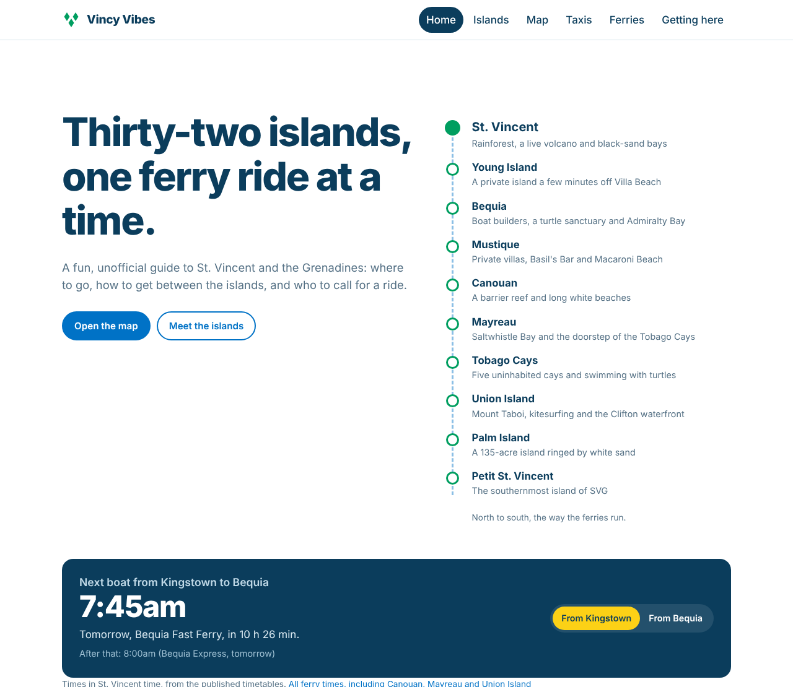
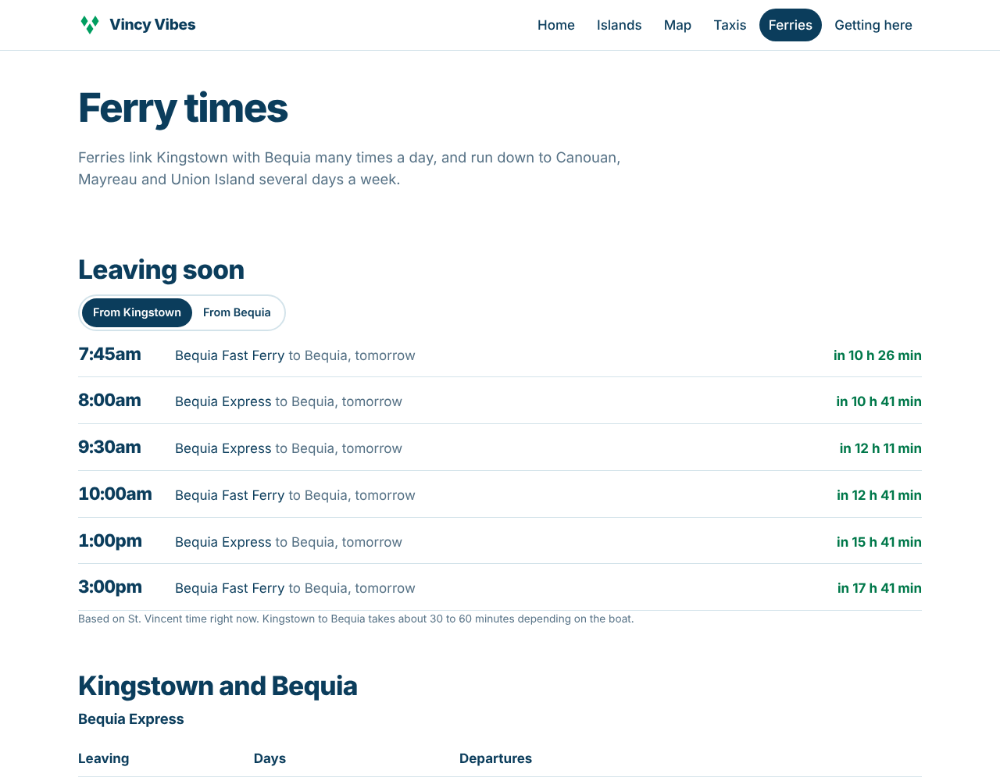
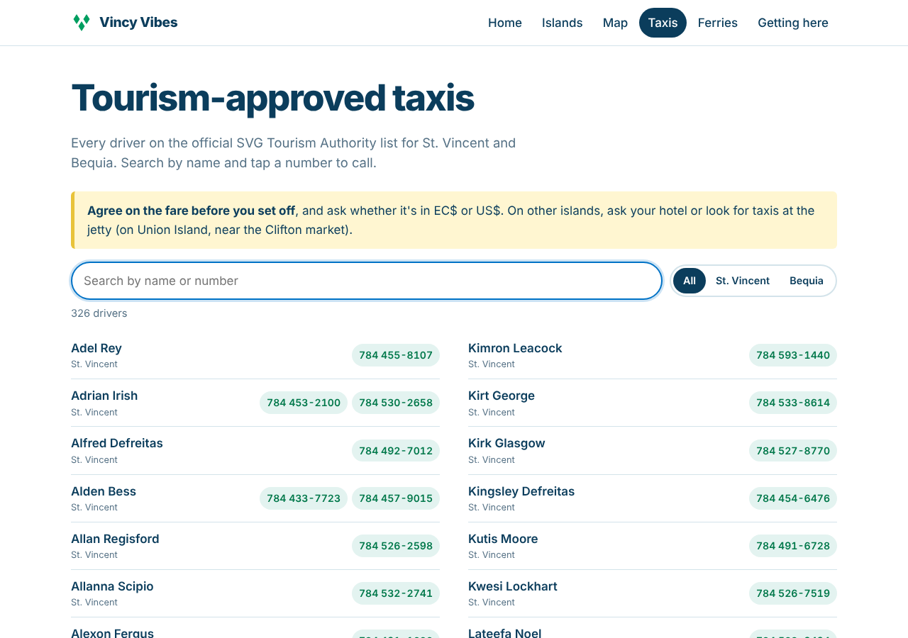
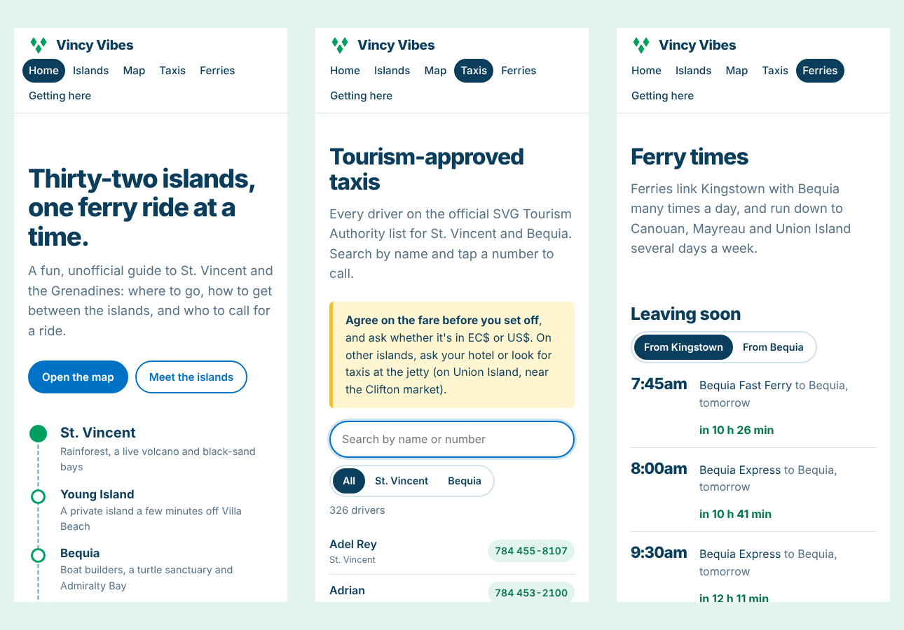

# Vincy Vibes

A fun, unofficial tourism guide to **St. Vincent and the Grenadines**: island guides, a map with GPS directions, the tourism-approved taxi directory, live ferry departures and flight info. Built with plain HTML, CSS and JavaScript and hosted free on GitHub Pages.

**Live site:** https://jody2905.github.io/vincy-vibes/



## Features

### The islands, north to south
The home page shows the islands as a ferry route, from St. Vincent down to Petit St. Vincent. Each island has its own page with an introduction, key facts, highlights, a map of its pins, and how to get there and get around. Islands still recovering from Hurricane Beryl (July 2024) are marked.

### Map with GPS
- An interactive map (Leaflet + OpenStreetMap) with pins for airports, ferry docks, beaches, sights, nature spots and towns, which you can filter by category
- Every pin shows its **GPS coordinates** and opens **directions in Google Maps or Apple Maps**
- **Near me:** with permission, the browser's location sorts every place by distance and shows the closest. The location stays in the browser and is never sent or stored

### Live ferry departures
The home page and ferry page work out the **next boats** between Kingstown and Bequia from the published timetables, counting down in St. Vincent time whatever time zone the visitor's phone is set to. The ferry page also has full timetables for the Bequia Express, Bequia Fast Ferry, MV Gem Star II and Jaden Sun.



### Approved taxi directory
All **326 tourism-approved taxi drivers** on St. Vincent and Bequia, searchable by name or number, filterable by island, with tap-to-call numbers.



### Getting here
Direct international flights, the five airports, local and regional airlines, entry requirements, money, driving and emergency numbers.

### Works on phones
Most visitors will use it on a phone while travelling, so every page is designed for small screens first.



## How it's built

| Part | How |
|---|---|
| Pages | Plain HTML and CSS, no framework or build step |
| Data | JavaScript files in `js/data/` (islands, map places, taxis, ferries, flights), so the site also works when opened straight from a folder |
| Map | [Leaflet](https://leafletjs.com/) with OpenStreetMap tiles |
| GPS | The browser Geolocation API, plus haversine distance in `js/site.js` |
| Ferry countdown | Converts the current time to St. Vincent time (UTC-4) before comparing with the timetables |
| Safety | All data shown on the page is HTML-escaped. External links open with `rel="noopener"` |
| Hosting | GitHub Pages |

```
index.html         Home: island chain, next ferry, tools, quick facts
islands.html       All islands
island.html        One island (island.html?id=bequia)
map.html           Map with GPS and near me
taxis.html         Approved taxi directory
ferries.html       Next departures and timetables
getting-here.html  Flights, airports, entry rules
css/style.css      Styles
js/site.js         Shared helpers (time, distance, directions, map markers)
js/*.js            One script per page
js/data/           Site content
```

## Run it locally

Double-click `index.html`. For the map's "Near me" button, browsers need the page served over `http://localhost` or `https://`:

```powershell
python -m http.server 8000
```

Then open http://localhost:8000.

## Sources

- [discoversvg.com](https://discoversvg.com/) (SVG Tourism Authority): island information, taxi list, ferry schedules, flights and entry requirements
- Wikipedia: island facts and GPS coordinates of towns, airports and landmarks
- Some beach and dock pins were placed by hand and are marked "approximate" on the map
- Information checked October 2026

## Roadmap

- [x] Phase 1: islands, map with GPS, taxis, ferries, getting here
- [ ] Phase 2: places to stay, things to do, festivals and events
- [ ] Phase 3: "Which island are you?" quiz, Vincy Mas countdown, day planner

---

*Vincy Vibes is an unofficial, fan-made portfolio project by Jody-Ann Trimmingham and is not affiliated with the St. Vincent and the Grenadines Tourism Authority. Schedules and phone numbers change, so always confirm before you travel.*
