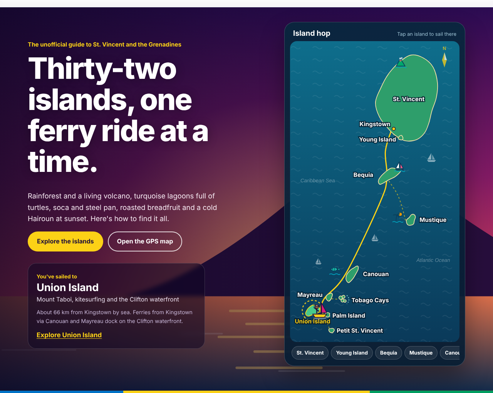
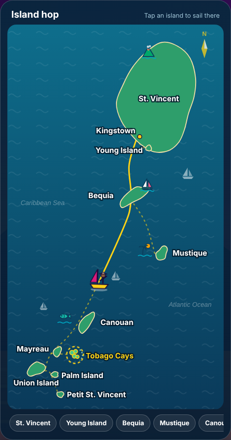
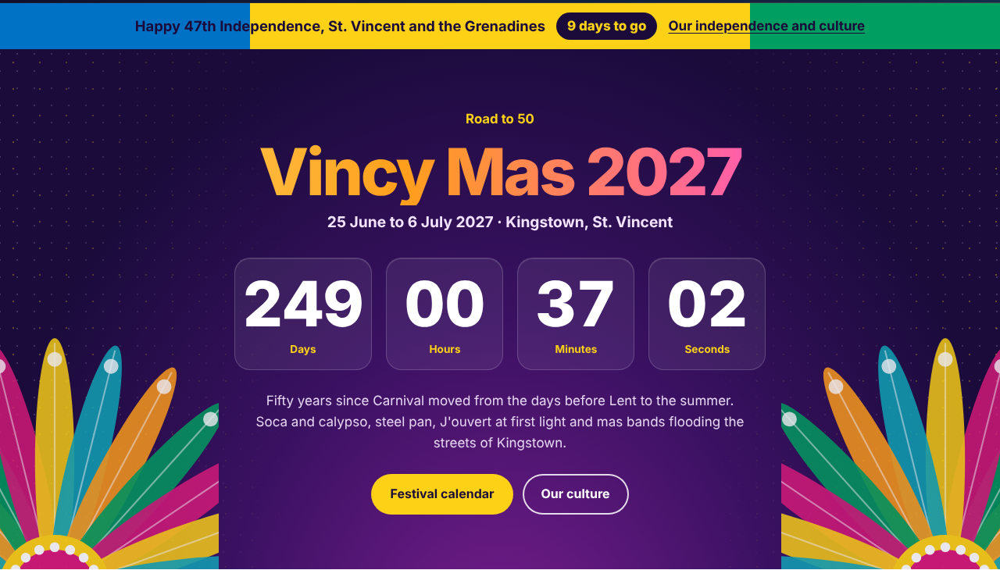
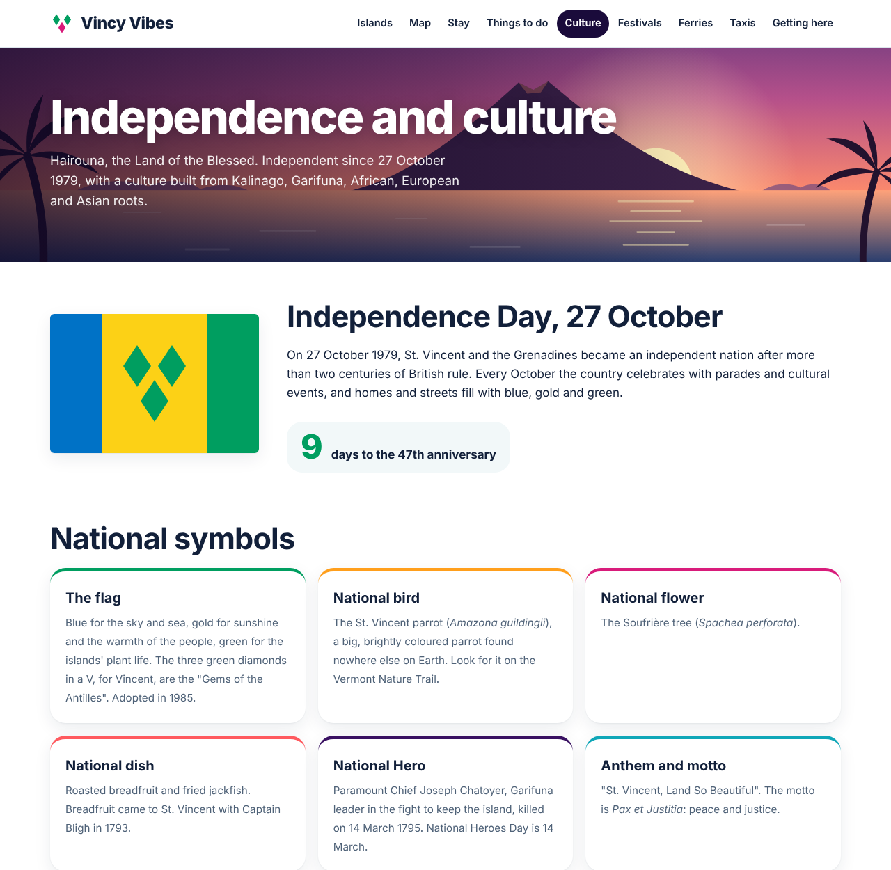
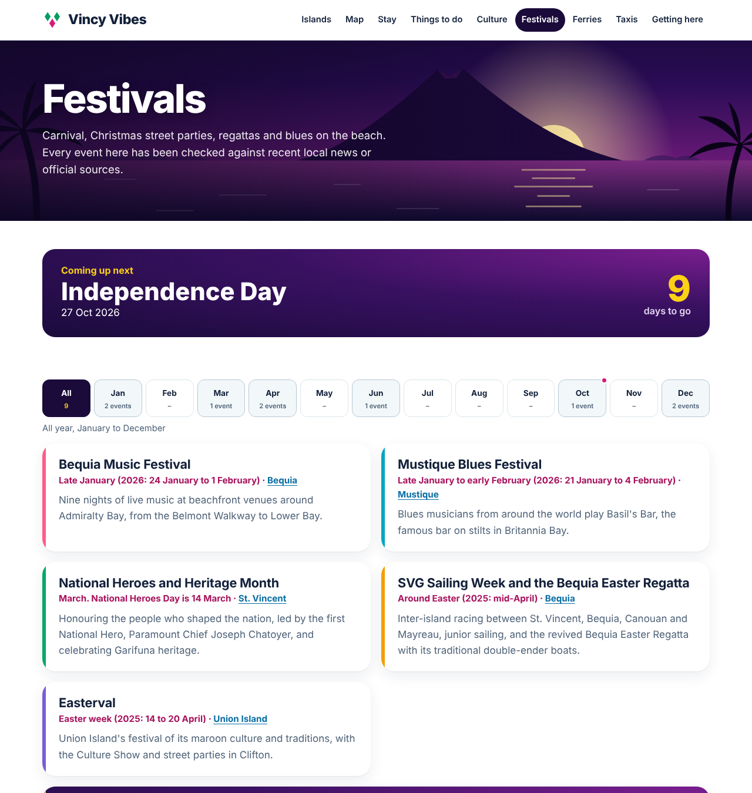
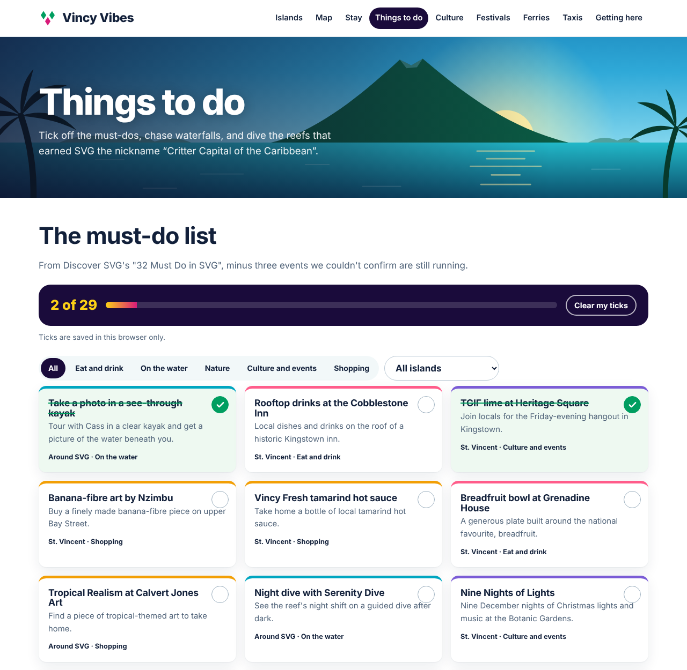

# Vincy Vibes

An unofficial, festive guide to **St. Vincent and the Grenadines**: carnival energy, island calm. It has an animated island-hopping map, a live Vincy Mas 2027 countdown, food, festivals, culture, places to stay, a GPS map, live ferry departures and the tourism-approved taxi directory. Built with plain HTML, CSS and JavaScript, with original SVG illustrations throughout, and hosted free on GitHub Pages.

**Live site:** https://jody2905.github.io/vincy-vibes/



## Highlights

### Island hop: an animated map
The home page keeps the original layout, with the headline on the left and the islands on the right, but the island list is now an **illustrated, clickable map**. The islands are drawn from real coordinates, with small markers for each one: La Soufrière on St. Vincent, a sailboat for Bequia, a palm and sun for Mustique. Pick an island and a little traveller in a sun hat **sails from Kingstown along the real ferry route** (Kingstown, Bequia, Canouan, Mayreau, Union), leaving a gold wake. The card beside the map shows the distance by sea and how to get there. It works with a mouse, touch, the keyboard, or the island chips under the map, and the animation switches off for visitors who've turned on reduced motion.



### Vincy Mas 2027 countdown
A full-width carnival band with feather fans and a live **days / hours / minutes / seconds** countdown to **Vincy Mas 2027: Road to 50** (25 June to 6 July 2027), counted in St. Vincent time. In October, an Independence ribbon in the flag's colours counts down to 27 October.



### The whole island experience
- **Island life:** beaches and reefs, rainforest and volcano, carnival and culture, festivals
- **Taste of Vincy:** roasted breadfruit and fried jackfish (the national dish), callaloo soup, madongo dumplings, banana fritters, Hairoun and Sunset rum
- **Independence and culture:** the flag, national symbols, Vincy Mas, Nine Mornings, Garifuna heritage and a short history



### Festivals, checked
A month-by-month calendar with a countdown to the next big date. **Every event was checked against recent local news or official sources** (October 2026):

| Event | Confirmed by |
|---|---|
| Bequia Music Festival (2026: 24 Jan to 1 Feb) | realgrenadines.com |
| Mustique Blues Festival (2026: 21 Jan to 4 Feb) | basilsbar.com, Citywealth |
| SVG Sailing Week and the revived Bequia Easter Regatta (April 2025) | Caribbean Compass |
| Easterval, Union Island (2025: 14 to 20 April) | insandoutsofsvg.com |
| Vincy Mas 2027 (25 June to 6 July) | Official save-the-date, iWitness News |
| Nine Nights of Lights, Botanic Gardens (2025: 15 to 23 Dec) | St Vincent Times |
| Nine Mornings (2025 launch at Heritage Square, 14 Dec) | One News St Vincent |

Removed because they couldn't be confirmed as still running: the Breadfruit Festival (last news coverage in 2018), the Mayreau Regatta (Mayreau now takes part in SVG Sailing Week), the Union Island Conch Festival and the full-moon kitesurf party.



### Travel tools
- **GPS map** (Leaflet + OpenStreetMap): every pin shows coordinates and opens Google Maps or Apple Maps directions; **Near me** sorts places by distance, without the location ever leaving the browser
- **Live ferry departures** between Kingstown and Bequia, plus full timetables for the southern Grenadines
- **326 tourism-approved taxi drivers** (270 on St. Vincent, 56 on Bequia), searchable, with tap-to-call
- **38 places to stay**, filterable by island and type
- **Bucket list** of 29 must-dos you can tick off (saved in your browser)



### Works on phones


## How it's built

| Part | How |
|---|---|
| Pages | Plain HTML and CSS, no framework or build step |
| Artwork | Original inline SVG: sunset scenes with La Soufrière and palms, carnival feather fans, island markers, the traveller. No photos, so nothing can fail to load |
| Island map | `js/hop.js`: projects real latitude and longitude onto the chart, smooths coastlines with Catmull-Rom curves, and animates the traveller along the route with `getPointAtLength` and `requestAnimationFrame` |
| Countdowns | Computed in St. Vincent time (UTC-4) whatever the visitor's time zone |
| Data | JavaScript files in `js/data/` (islands, places, taxis, ferries, flights, stays, must-dos, festivals) |
| GPS | Browser Geolocation API and haversine distance |
| Safety and access | All data is HTML-escaped; keyboard support and visible focus; reduced motion respected |
| Design | Bricolage Grotesque and Manrope; Vincy Mas night-indigo and magenta, flag gold and green, sea turquoise and sunset coral |
| Hosting | GitHub Pages |

```
index.html         Home: island-hop map, Vincy Mas countdown, island life, food, travel tools
islands.html       All islands         island.html   One island (island.html?id=bequia)
map.html           GPS map             stay.html     Places to stay
things-to-do.html  Bucket list, nature, diving
culture.html       Independence, symbols, Vincy Mas, history
festivals.html     Verified festival calendar
ferries.html       Next departures and timetables
taxis.html         Approved taxi directory
getting-here.html  Flights, airports, entry rules
css/style.css      Styles        js/       Scripts (hop.js = island map)
```

## Run it locally

```powershell
python -m http.server 8000
```

Then open http://localhost:8000. (Opening `index.html` directly also works, but browsers only allow "Near me" over `http://localhost` or `https://`.)

## Sources

- [discoversvg.com](https://discoversvg.com/) (SVG Tourism Authority): islands, places to stay, must-dos, eco-adventures, dive sites, taxis, ferries, flights and entry requirements
- Government of St. Vincent and the Grenadines: national symbols
- Local news and organisers for festivals (see the table above)
- Wikipedia: island facts and GPS coordinates; some beach and dock pins are marked "approximate"

## Roadmap

- [x] Phase 1: islands, GPS map, taxis, ferries, getting here
- [x] Phase 2: places to stay, bucket list, festivals, independence and culture
- [x] Redesign: animated island-hopping map, Vincy Mas countdown, illustrated Vincentian theme, verified events
- [ ] Next: "Which island are you?" quiz and a day planner

---

*Vincy Vibes is an unofficial, fan-made portfolio project by Jody-Ann Trimmingham and is not affiliated with the St. Vincent and the Grenadines Tourism Authority. Schedules, phone numbers and event dates change, so always confirm before you travel.*
