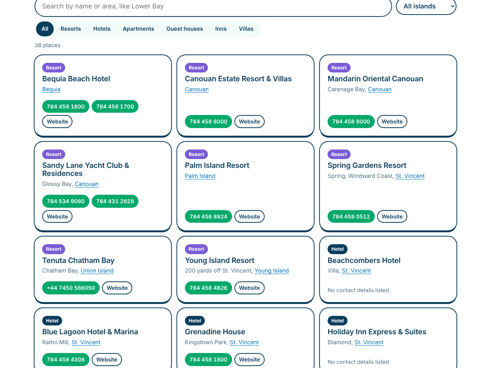

# Vincy Vibes

A fun, unofficial tourism guide to **St. Vincent and the Grenadines**: island guides, a map with GPS directions, places to stay, a tick-off bucket list of 32 must-dos, a festival calendar with countdown, live ferry departures and the tourism-approved taxi directory. Built with plain HTML, CSS and JavaScript and hosted free on GitHub Pages.

**Live site:** https://jody2905.github.io/vincy-vibes/


## Features

### The islands, north to south
The home page opens with a full-width photo, an Independence banner with a live countdown (it switches to a Vincy Mas 2027 countdown after October), and the islands listed as a ferry route from St. Vincent down to Petit St. Vincent. Each island has its own illustrated bullet: a volcano for St. Vincent, a sailboat for Bequia, a turtle for the Tobago Cays, Mount Taboi for Union Island. Each island has its own page with an introduction, key facts, highlights, a map of its pins, and how to get there and get around. Islands still recovering from Hurricane Beryl (July 2024) are marked.

### Map with GPS
- An interactive map (Leaflet + OpenStreetMap) with pins for airports, ferry docks, beaches, sights, nature spots and towns, which you can filter by category
- Every pin shows its **GPS coordinates** and opens **directions in Google Maps or Apple Maps**
- **Near me:** with permission, the browser's location sorts every place by distance and shows the closest. The location stays in the browser and is never sent or stored

### Independence and culture
A page celebrating independence (27 October 1979), with the flag drawn in SVG, the national symbols (parrot, Soufrière tree, roasted breadfruit and jackfish, Chatoyer, anthem and motto), **Vincy Mas 2027: Road to 50** (25 June to 6 July 2027) with a countdown, living traditions like Nine Mornings and Garifuna heritage, and a short history timeline.


### Places to stay
38 resorts, hotels, apartments, guest houses, inns and villas from the Discover SVG listings. You can filter them by island and type or search by name or area, and each listing has tap-to-call numbers and a website link.



### Things to do: a bucket list
The official "32 Must Do in SVG" as postcards you can **tick off**. Progress is saved in your browser, so you can keep track during a trip. You can filter by category (eat and drink, on the water, nature, culture, shopping) or island. The page also has waterfalls, trails and gardens, and top dive sites in the "Critter Capital of the Caribbean".


### Festivals
A month-by-month calendar of Vincy Mas, Nine Mornings, the Bequia Easter Regatta, the Mustique Blues Festival and more, with a **countdown to the next big date** worked out in St. Vincent time.


### Live ferry departures
On the home page, a little boat sails along the route as the next departure gets closer. The home page and ferry page work out the **next boats** between Kingstown and Bequia from the published timetables, counting down in St. Vincent time whatever time zone the visitor's phone is set to. The ferry page also has full timetables for the Bequia Express, Bequia Fast Ferry, MV Gem Star II and Jaden Sun.


### Approved taxi directory
All **326 tourism-approved taxi drivers** (270 on St. Vincent, 56 on Bequia), searchable by name or number, filterable by island, with tap-to-call numbers. The count always shows the island breakdown.


### Getting here
Direct international flights, the five airports, local and regional airlines, entry requirements, money, driving and emergency numbers.

### Fun to use, and works on phones
Page headers use real photos of the islands from Unsplash (credited on each photo), every island has its own colour, page headers end in waves, and the home page has a sailboat crossing the sea and a "Did you know?" fact you can tap for another. Animations switch off for visitors who've turned on reduced motion. Most people will use the site on a phone while travelling, so every page works on small screens, with a tap-to-open menu.


## How it's built

| Part | How |
|---|---|
| Pages | Plain HTML and CSS, no framework or build step |
| Data | JavaScript files in `js/data/` (islands, map places, taxis, ferries, flights), so the site also works when opened straight from a folder |
| Map | [Leaflet](https://leafletjs.com/) with OpenStreetMap tiles |
| GPS | The browser Geolocation API, plus haversine distance in `js/site.js` |
| Ferry countdown | Converts the current time to St. Vincent time (UTC-4) before comparing with the timetables |
| Bucket list | Saved with `localStorage`, wrapped so the page still works if the browser blocks storage |
| Design | Fredoka and Rubik fonts, flag-inspired colours plus one colour per island, hand-drawn SVG icons and waves |
| Safety | All data shown on the page is HTML-escaped. External links open with `rel="noopener"` |
| Hosting | GitHub Pages |

```
index.html         Home: island chain, sailing ferry countdown, facts
islands.html       All islands
island.html        One island (island.html?id=bequia)
map.html           Map with GPS and near me
stay.html          Places to stay
culture.html       Independence, national symbols, Vincy Mas, history
things-to-do.html  32 must-dos bucket list, nature, diving
festivals.html     Festival calendar and countdown
taxis.html         Approved taxi directory
ferries.html       Next departures and timetables
getting-here.html  Flights, airports, entry rules
css/style.css      Styles
js/site.js         Shared helpers (time, distance, directions, map markers)
js/*.js            One script per page
js/data/           Site content
```

## Run it locally

Double-click `index.html`. For the map's "Near me" button, browsers need the page served over `http://localhost` or `https://`:

```powershell
python -m http.server 8000
```

Then open http://localhost:8000.

## Sources

- [discoversvg.com](https://discoversvg.com/) (SVG Tourism Authority): island information, places to stay, 32 must-dos, eco-adventures, dive sites, festivals, taxi list, ferry schedules, flights and entry requirements
- Festival months from Discover SVG event pages and local news reports; Vincy Mas 2027 dates from the official save-the-date announcement
- National symbols from the Government of St. Vincent and the Grenadines
- Photos from [Unsplash](https://unsplash.com/license) by Andre Alexander, George Apodaca, Hugh Whyte, Bradley Wade, Sam Hallett, Christian Lendl, Susy Ross, JR Harris, David Ballinger and Garance de Reynal
- Wikipedia: island facts and GPS coordinates of towns, airports and landmarks
- Some beach and dock pins were placed by hand and are marked "approximate" on the map
- Information checked October 2026

## Roadmap

- [x] Phase 1: islands, map with GPS, taxis, ferries, getting here
- [x] Phase 2: a more playful design, places to stay, things-to-do bucket list, festival calendar, photo headers, independence and culture
- [ ] Phase 3: "Which island are you?" quiz, Vincy Mas countdown, day planner

---

*Vincy Vibes is an unofficial, fan-made portfolio project by Jody-Ann Trimmingham and is not affiliated with the St. Vincent and the Grenadines Tourism Authority. Schedules and phone numbers change, so always confirm before you travel.*
